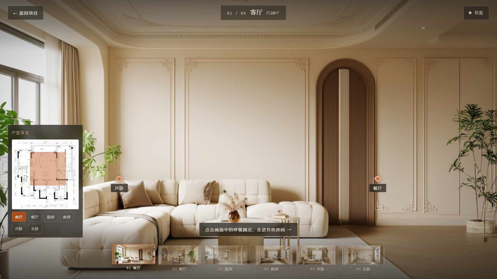
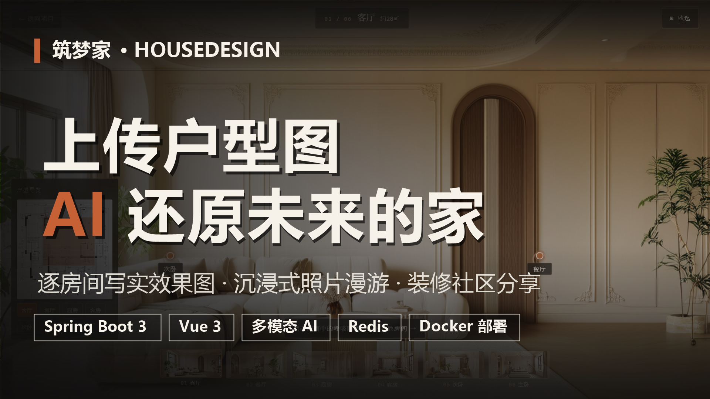
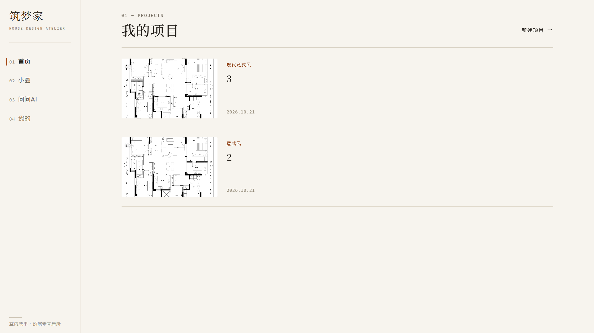
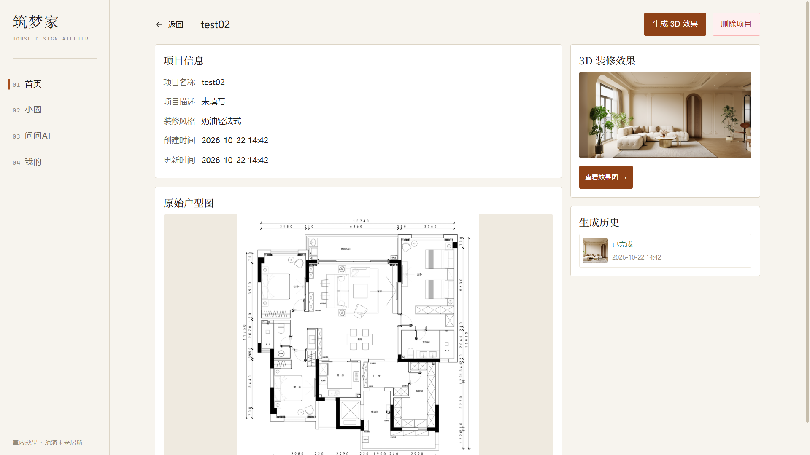
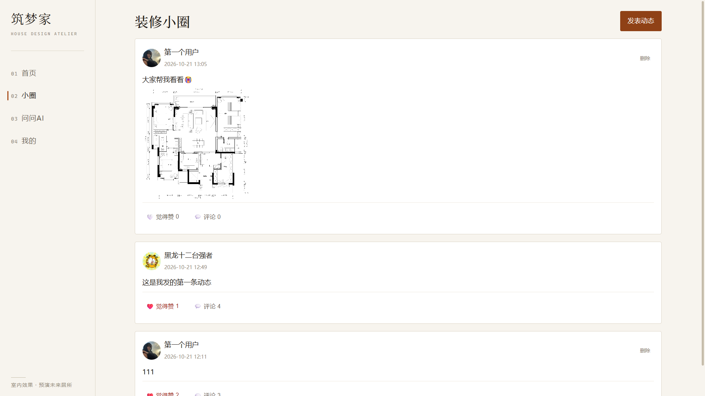
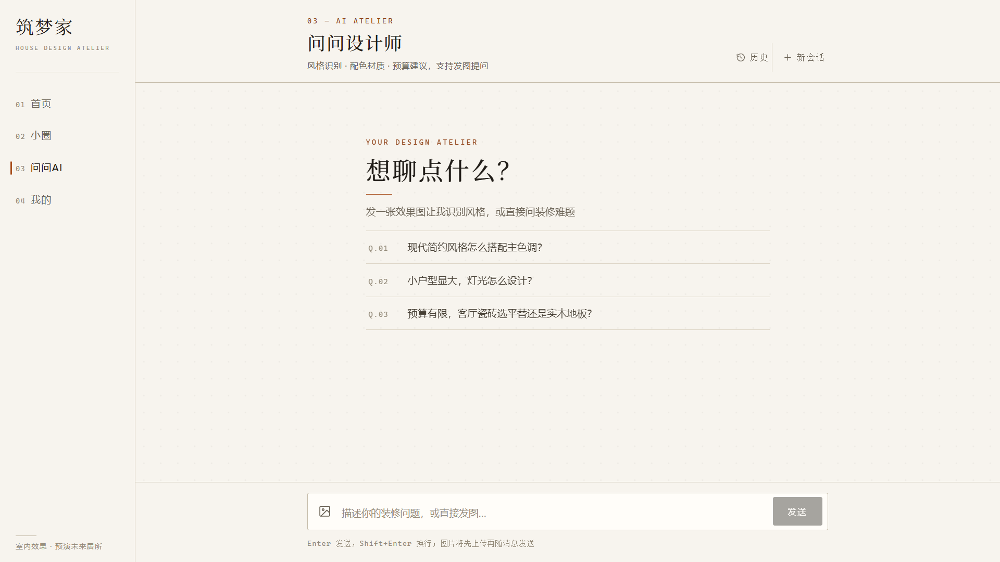
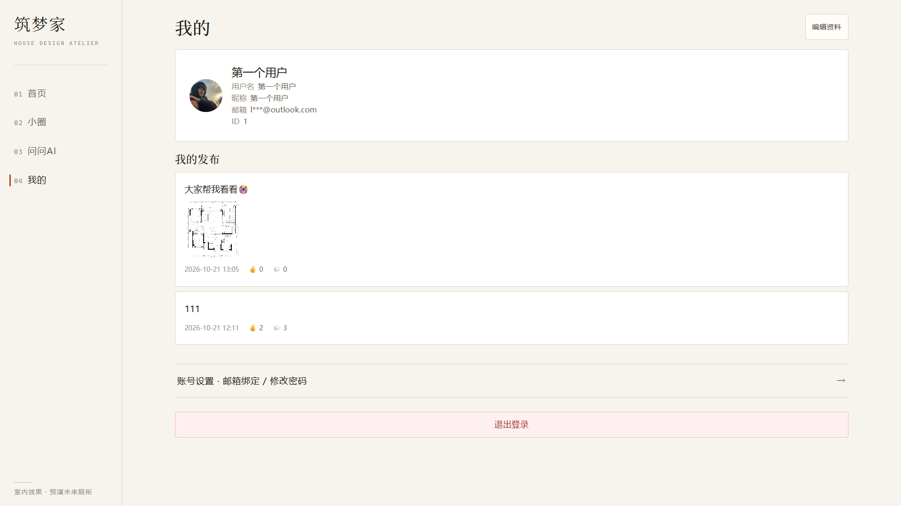
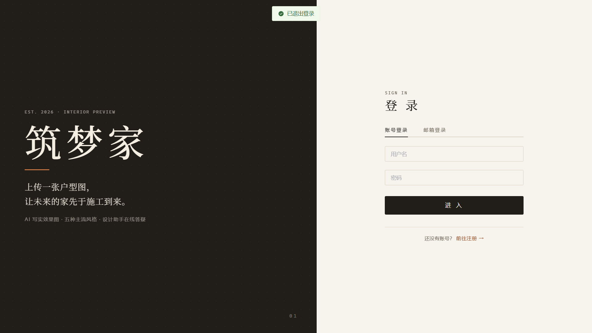

# 筑梦家 HouseDesign · 住宅装修效果可视化平台

<div align="center">

**上传一张户型图，AI 还原每个房间的写实效果图，沉浸式漫游未来的家。**


[](https://www.bilibili.com/video/BV1Xony6eEPQ)

**▶ [B 站视频演示](https://www.bilibili.com/video/BV1Xony6eEPQ)** · **📍 项目地址：[github.com/6myname6/house-design](https://github.com/6myname6/house-design)**

</div>

## 项目简介

装修最痛的点在于：**施工前谁也不知道装完长什么样**。筑梦家把这一步交给 AI——业主上传户型图，系统先由多模态视觉模型「读懂」房间结构与拓扑，再逐房间生成写实装修效果图，最终以可交互的照片漫游方式呈现，并提供社区让业主分享交流。

这是一个**个人独立全栈项目**：从需求分析、接口/数据库设计，到前后端编码、AI 链路调优，再到 Docker 容器化部署上线，全流程单人完成，按企业标准沉淀了需求文档、接口契约、数据库设计与开发待办四类工程文档。

| | |
| --- | --- |
| 后端 | Spring Boot 3 + MyBatis-Plus + JWT + Redis 7 + MySQL 8，阿里云 OSS 存储 |
| 前端 | Vue 3.5 + Vite 5 + Element Plus + Pinia，杂志风设计体系 |
| AI | 阿里云百炼：Qwen3-VL-Plus（多模态对话/户型识别）+ 万相 wanx2.1-t2i-turbo（文生图），LangChain4j + DashScope 接入 |
| 部署 | Docker Compose 五服务编排，healthcheck 编排 + 每日自动备份 |

## 核心功能

| 模块 | 能力说明 |
| --- | --- |
| **账号体系** | 用户名密码 / 邮箱验证码注册登录（QQ SMTP 真实发信）、邮箱改密、资料编辑、退出登录；JWT 鉴权，登录失败限流（Redis，连败 5 次锁 10 分钟） |
| **AI 效果图生成** | 户型图 → Qwen3-VL-Plus 视觉识别房间拓扑/面积/bbox → 万相 wanx2.1-t2i-turbo 逐房间写实生图（最多 6 间）→ 异步任务 + 状态轮询（PENDING→PROCESSING→SUCCESS/FAILED）→ 结果转存阿里云 OSS |
| **照片漫游** | Viewer3D 全屏沉浸式预览：呼吸热点跳房、Ken Burns 缓慢扫视 + 鼠标视差营造空间感、户型小地图四向联动、缩略图条、键盘 ←/→ 切换房间 |
| **AI 设计助手** | 基于 LangChain4j + Qwen3-VL-Plus 的多模态对话：纯文本 / 图片 / 图文混合提问，装修风格识别、配色与建材建议，支持会话历史 |
| **装修小圈** | 图文发帖、两级楼中楼评论、帖子/评论独立点赞（UNIQUE 约束防重）、我的帖子、删帖级联清理 |
| **设计项目** | 5 种预设风格 + 自定义风格要求双输入；项目增删查全程服务端归属校验，404 防枚举探测 |
| **工程化配套** | 统一上传（扩展名白名单 + UUID 重命名）→ OSS 公网 URL；Swagger 在线接口文档；12 个单元测试全绿 |

## 项目预览

**完整操作演示**（登录 → 创建项目 → AI 生成 → 漫游预览）：

[](https://www.bilibili.com/video/BV1Xony6eEPQ)

> 📺 [B 站观看完整演示](https://www.bilibili.com/video/BV1Xony6eEPQ)：上传户型图 → AI 视觉识别房间 → 逐房间生成写实效果图 → 沉浸式漫游预览

| 我的项目 | 项目详情（户型图 → AI 效果图） |
| --- | --- |
|  |  |
| **装修小圈** | **问问设计师（多模态 AI 对话）** |
|  |  |
| **个人中心** | **登录页** |
|  |  |

## 核心亮点


1. **AI 生成是两阶段 Pipeline，不是简单调 API**：先用视觉模型把户型图转成结构化 JSON（房间、连接拓扑、估算面积、bbox），经规范化校验（连接双向闭合、bbox 裁剪、房间数截断）后，再逐房间文生图、组装 photo-tour 场景配置——这是「一张图」变「可漫游的家」的关键设计。
2. **异步任务 + 分布式防并发**：生成任务走独立线程池 + 状态机轮询；同一项目并发提交用 Redis SETNX 兜底（终态 finally 释放 + 30min TTL 防死锁），并行双发实测严格返回 200 + 409，复测记录见 [docs/TODO.md](docs/TODO.md)。
3. **一个 Redis 实例，四类键设计**：登录限流（INCR + EXPIRE）、邮箱验证码（TTL + 一次性）、退出登录 token 黑名单、生成防并发锁——四种场景各自独立的键结构与过期策略，键设计见 [docs/数据库设计.md](docs/数据库设计.md) 末尾。
4. **LangChain4j 声明式 + 原生双路接入**：纯文本对话走 `@AiService` + `@SystemMessage` 角色设定；图文链路因 1.0.1 版本 AiService 不支持图片参数，降级直连 `ChatModel` 手工组装 `TextContent + ImageContent` 多模态消息；模型 429/超时/5xx 统一转译为 503 友好提示，401 配置错误不吞。
5. **JWT + ThreadLocal 用户上下文**：拦截器校验 token 后写入 `UserContext`，`afterCompletion` 强制清理防止线程池复用串号；所有资源归属一律从服务端上下文取用户 ID，前端伪造无效。
6. **文件存储接口化抽象**：`FileStorageService` 接口 + 模板方法基类（校验/UUID 命名/MIME 映射），唯一实现为阿里云 OSS；启动时 fail-fast 校验密钥、显式设置 Content-Type 与一年缓存头，业务层与前端对存储介质零感知。
7. **社区数据一致性**：点赞表 `UNIQUE(目标id, user_id)` 数据库层防重；删帖 `@Transactional` 级联删除评论与两类点赞；`comment_count` 冗余计数器换列表页查询性能。
8. **生产级容器化部署**：Compose 五服务编排（Nginx / 后端 / MySQL / Redis / 备份 sidecar），healthcheck 探活聚合健康（actuator 校验 MySQL+Redis 连通）而非进程存活来控制启动顺序；日志轮转、优雅停机、容器时区对齐北京时间、mysqldump 每日自动备份保留 7 份。

## 技术栈

| 端 | 技术 | 用途 |
| --- | --- | --- |
| 后端 | Spring Boot 3.2.5 / JDK 17 | Web 服务、内嵌 Tomcat、异步生成线程池 |
| 后端 | MyBatis-Plus | ORM：BaseMapper 通用 CRUD + LambdaQueryWrapper + 分页插件 |
| 后端 | JWT（jjwt） | 登录鉴权 + 接口归属校验（拦截器 + ThreadLocal） |
| 后端 | Redis 7（Lettuce） | 登录限流 / 邮箱验证码 / token 黑名单 / 生成防并发锁 |
| 后端 | MySQL 8 / BCrypt | 数据存储 / 密码加密 |
| 后端 | Spring WebFlux WebClient | 异步调用外部文生图 API |
| 后端 | LangChain4j 1.0.1-beta6 | 声明式 AI Service + 原生 ChatModel 多模态接入 |
| 后端 | springdoc-openapi / Actuator | Swagger 接口文档 / 健康探针 |
| 前端 | Vue 3.5 + Vite 5 + Element Plus | SPA 界面 + 组件库 |
| 前端 | Pinia / Vue Router / Axios | 状态管理 / 路由 / 请求与拦截器封装 |
| 前端 | marked + DOMPurify | AI 回复 Markdown 渲染 + XSS 消毒 |
| 前端 | SCSS 设计令牌 | 「编辑杂志 · 建筑工作室」设计体系：纸感米白/墨黑/陶土、衬线展示字 + 细发线分层 |
| AI | 阿里云百炼 Qwen3-VL-Plus | 户型图视觉识别 + 多模态设计对话（OpenAI 兼容协议） |
| AI | 阿里云百炼 wanx2.1-t2i-turbo | 逐房间写实效果图生成（DashScope 异步任务，模型名配置化） |
| 部署 | Docker Compose + Nginx | 五服务编排、静态资源托管、/api 反向代理 |

## 快速启动

### 方式一：Docker Compose 一键部署（推荐）

前置：Docker + Node.js（构建前端静态资源）。

```bash
git clone https://github.com/6myname6/house-design.git
cd house-design

# 1. 构建前端静态资源
cd frontend && npm install && npm run build && cd ..

# 2. 在 deploy/.env 注入密钥（模板见下方环境变量表）
vim deploy/.env

# 3. 一键启动（MySQL 首启自动建库建表，Redis 带 AOF 持久化，每日自动备份）
cd deploy && docker compose up -d --build
```

启动顺序由 healthcheck 编排：MySQL/Redis 就绪 → 后端健康（actuator 聚合探活）→ Nginx 挂载流量。访问 `http://localhost` 即可。

### 方式二：本地开发

**环境要求**：JDK 17+ / Maven 3.8+ / MySQL 8.x / Redis 7.x / Node.js 18+，以及阿里云 OSS（公共读 bucket，文件存储唯一后端，未配置密钥后端启动即失败）与阿里云百炼 API Key（[bailian.console.aliyun.com](https://bailian.console.aliyun.com) 开通）。

**1. 环境变量**（密钥一律环境变量注入，代码库零落地）

| 变量 | 说明 |
| --- | --- |
| `DB_PASSWORD` | MySQL 密码（URL 已带 `createDatabaseIfNotExist=true`，首次启动自动建库） |
| `REDIS_PASSWORD` | Redis 密码 |
| `OSS_ACCESS_KEY_ID` / `OSS_ACCESS_KEY_SECRET` | 阿里云 OSS 密钥（bucket/endpoint 在 `application.yml` 的 `app.storage.oss` 调整） |
| `BAILIAN_API_KEY` | 阿里云百炼 Key（效果图生成与 AI 对话共用） |
| `MAIL_USERNAME` / `MAIL_PASSWORD` | QQ 邮箱 SMTP 账号与授权码（邮箱注册/验证码登录用） |
| `JWT_SECRET` | JWT 签名密钥（生产必须覆盖默认值） |

**2. 启动 Redis**

```bash
docker run -d --name house-redis -p 6379:6379 redis:7
```

**3. 启动后端**（默认 :8080，建表脚本 `backend/src/main/resources/db/house_design.sql` 首次需手动执行）

```bash
cd backend
mvn spring-boot:run
# 接口文档：http://localhost:8080/swagger-ui.html
```

**4. 启动前端**（默认 :5173，`/api` 已代理到 8080）

```bash
cd frontend
npm install
npm run dev
```

## 目录结构

```
HouseDesign/
├── backend/                          # Spring Boot 后端
│   └── src/main/java/com/housedesign/
│       ├── config/                   # Web / MyBatis-Plus(分页) / OpenAPI / Async 线程池 / AiConfig(ChatModel)
│       ├── common/                   # Result 统一响应 / 全局异常 / UserContext / LoginRateLimiter
│       ├── controller/               # Controller（薄：收参 → 调服务 → 包 Result）
│       ├── dto/                      # request / response（含 ai、scene 等子包）
│       ├── entity / mapper/          # MyBatis-Plus 实体与 BaseMapper
│       ├── interceptor/              # JwtInterceptor（token 校验 + 用户上下文注入）
│       ├── Service/                  # 业务接口 + impl（含 AI/ 子包：声明式 AiService + 多模态对话）
│       └── util/                     # JwtUtil 等工具
│   └── src/main/resources/
│       ├── application.yml           # 配置（敏感项全部环境变量注入）
│       └── db/house_design.sql       # 建表脚本
├── frontend/                         # Vue 3 前端
│   └── src/
│       ├── api/                      # Axios 接口封装
│       ├── views/                    # Login / Register / Home / CreateProject / ProjectDetail
│       │                             # / Community / AiChat / Profile / Settings / Viewer3D
│       ├── layout / router / stores/ # 主框架布局 / 路由 / Pinia 状态
│       └── styles/                   # SCSS 设计令牌（杂志风设计体系）
├── deploy/                           # 生产部署
│   ├── docker-compose.yml            # 五服务编排（nginx/backend/mysql/redis/备份）
│   ├── nginx.conf                    # 静态托管 + /api 反代
│   └── backup.sh                     # mysqldump 每日备份，保留 7 份
└── docs/                             # 需求 / 产品 / 接口 / 数据库 / 部署 / 待办
    └── images/                       # README 截图与演示视频封面资源
```

## 数据库设计（7 张表）

| 表 | 说明 | 关键设计 |
| --- | --- | --- |
| `t_user` | 用户 | BCrypt 密码；`email` 唯一索引 |
| `t_design_project` | 设计项目 | `user_id` 归属；`style`（自定义要求）+ `style_label`（预设 code）双字段 |
| `t_generated_model` | AI 生成任务与结果 | 状态枚举 + `project_id`；`scene_config`（photo-tour 场景 JSON，LONGTEXT） |
| `t_post` | 社区帖子 | `comment_count` 冗余计数器 |
| `t_post_comment` | 评论 | 两级楼中楼（`parent_id`）+ 图文评论（`images` JSON） |
| `t_post_like` | 帖子点赞 | `UNIQUE(post_id, user_id)` 防重复赞 |
| `t_comment_like` | 评论点赞 | `UNIQUE(comment_id, user_id)`，独立于帖子点赞 |

详见 [docs/数据库设计.md](docs/数据库设计.md)（含 Redis 键设计）与 [docs/接口文档.md](docs/接口文档.md)。

## 项目文档

| 文档 | 内容 |
| --- | --- |
| [docs/需求文档.md](docs/需求文档.md) | 需求条目编号与验收标准 |
| [docs/产品文档.md](docs/产品文档.md) | 页面与交互设计 |
| [docs/接口文档.md](docs/接口文档.md) | 全量 HTTP 接口契约 |
| [docs/数据库设计.md](docs/数据库设计.md) | 表结构与 Redis 键设计 |
| [docs/部署文档.md](docs/部署文档.md) | 云服务器部署与上线流程 |
| [docs/TODO.md](docs/TODO.md) | 开发里程碑与实测记录 |

## Roadmap

- [ ] 上传文件 Magic Number 校验（当前为扩展名白名单），防伪装文件
- [ ] CORS 收敛到可信域名白名单
- [ ] 照片漫游向真 3D 渲染（Three.js / WebGL 全景）演进
- [ ] 生成效果评价回流，沉淀提示词优化依据

## License

MIT

---

*个人项目 · 作者：[6myname6](https://github.com/6myname6)*
