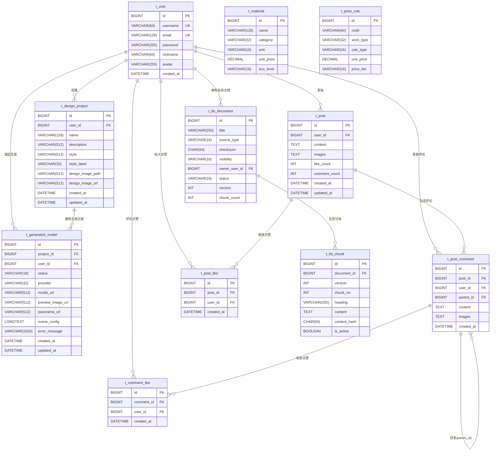

# 筑梦家 · 数据库设计

> 基于 MyBatis-Plus 实体（`com.housedesign.entity`）与 `backend/src/main/resources/db/house_design.sql` 整理，数据库使用 MySQL 8。
> 关联均为**逻辑外键**（实体只存 `Long` 字段，无数据库级外键约束），由应用层保证完整性。
> 建表脚本为 `house_design.sql`（`CREATE TABLE IF NOT EXISTS`）；**已存在的表不会自动加列**，表结构变更需手动执行 ALTER（见 §2 迁移说明）。

---

## 表结构总览

| 表名 | 实体 | 说明 |
| --- | --- | --- |
| `t_user` | User | 用户 |
| `t_design_project` | DesignProject | 设计项目（一张设计图 = 一个项目） |
| `t_generated_model` | GeneratedModel | AI 生成任务与结果 |
| `t_post` | Post | 装修小圈帖子 |
| `t_post_comment` | PostComment | 帖子评论（两级：parent_id 支持楼中楼） |
| `t_post_like` | PostLike | 帖子点赞 |
| `t_comment_like` | CommentLike | 评论点赞（独立于帖子点赞） |
| `t_ai_session` | AiChatSession | AI 会话元数据（A-13 跨浏览器历史） |
| `t_ai_message` | AiChatMessage | AI 会话消息正文（user / assistant） |
| `t_kb_document` | KbDocument | 知识库文档元数据（PENDING → PARSING → INDEXING → READY / FAILED） |
| `t_kb_chunk` | KbChunk | 知识库分块正文，含 ngram 全文索引 |
| `t_material` | —（待补实体） | 材料库，供 Agent 工具查询精确价格 |
| `t_price_rule` | —（待补实体） | 施工工序计价规则，三档 price_tier |
| `kb_chunk_vector` | —（无实体，JdbcTemplate 访问） | 分块向量，**位于 PostgreSQL（pgvector）库 `kb_vector`，非 MySQL** |

---

## 1. `t_user` — 用户表

| 字段 | 类型 | 约束 | 说明 |
| --- | --- | --- | --- |
| `id` | BIGINT | PK，自增 | 用户 ID |
| `username` | VARCHAR(64) | NOT NULL，**UNIQUE** | 用户名；邮箱注册（用户名+邮箱+验证码+密码）时由用户填写，3-32 字符 |
| `email` | VARCHAR(128) | **UNIQUE**，允许 NULL | 邮箱（A-11 新增，2026-10-15）；2026-10-21 手机通道下线后为账号唯一联系标识 |
| `password` | VARCHAR(255) | 允许 NULL | BCrypt 加密存储；注册必填密码；历史无密码账号该字段为 NULL |
| `nickname` | VARCHAR(64) | | 昵称，默认为 username |
| `avatar` | VARCHAR(255) | | 头像 URL |
| `created_at` | DATETIME | NOT NULL | 创建时间（不可更新） |

> **A-10 变更（2026-09-21）**：新增 `phone` 列与唯一索引 `uk_phone`，`password` 放宽为可空。建表语句在 `db/house_design.sql` 同步修改；存量库执行：
>
> ```sql
> ALTER TABLE `t_user`
>     ADD COLUMN `phone` VARCHAR(11) NULL COMMENT '手机号' AFTER `username`,
>     ADD UNIQUE KEY `uk_phone` (`phone`),
>     MODIFY COLUMN `password` VARCHAR(255) NULL COMMENT '密码（BCrypt，短信注册用户可空）';
> ```
>
> **A-10 下线变更（2026-10-21）**：手机号注册/登录功能整体下线，`phone` 列与 `uk_phone` 索引删除（建表语句已同步删除）；存量库执行：
>
> ```sql
> ALTER TABLE `t_user`
>     DROP INDEX `uk_phone`,
>     DROP COLUMN `phone`;
> ```

> **A-11 变更（2026-10-15）**：新增 `email` 列与唯一索引 `uk_email`，支持邮箱注册与邮箱验证码登录；建表语句在 `db/house_design.sql` 同步修改；存量库执行：
>
> ```sql
> ALTER TABLE `t_user`
>     ADD COLUMN `email` VARCHAR(128) NULL COMMENT '邮箱（A-11 邮箱注册/登录）' AFTER `phone`,
>     ADD UNIQUE KEY `uk_email` (`email`);
> ```

## 2. `t_design_project` — 设计项目表

| 字段 | 类型 | 约束 | 说明 |
| --- | --- | --- | --- |
| `id` | BIGINT | PK，自增 | 项目 ID |
| `user_id` | BIGINT | NOT NULL | 归属用户（逻辑外键 → `t_user.id`） |
| `name` | VARCHAR(128) | NOT NULL | 项目名称 |
| `description` | VARCHAR(512) | | 项目描述 |
| `style` | VARCHAR(512) | | 用户自定义风格要求（自由文本，如「原木色、温馨、多绿植」），与 `style_label` 至少填一个 |
| `style_label` | VARCHAR(32) | | 预设风格 code（见 `DesignStyle` 枚举），与 `style` 至少填一个 |
| `design_image_path` | VARCHAR(512) | | 设计图相对路径（storage 下） |
| `design_image_url` | VARCHAR(512) | | 设计图可访问 URL |
| `created_at` | DATETIME | NOT NULL | 创建时间 |
| `updated_at` | DATETIME | NOT NULL | 更新时间 |

> **注意**：若库中已有旧表（原 `style VARCHAR(32)` 无 `style_label`），需手动执行迁移：
>
> ```sql
> ALTER TABLE t_design_project
>     MODIFY COLUMN `style` VARCHAR(512) DEFAULT NULL COMMENT '用户自定义风格要求（自由文本）',
>     ADD COLUMN `style_label` VARCHAR(32) DEFAULT NULL COMMENT '预设风格 code（DesignStyle）' AFTER `style`;
> ```

## 3. `t_generated_model` — 生成任务表

| 字段 | 类型 | 约束 | 说明 |
| --- | --- | --- | --- |
| `id` | BIGINT | PK，自增 | 任务 ID |
| `project_id` | BIGINT | NOT NULL | 所属项目（逻辑外键 → `t_design_project.id`） |
| `user_id` | BIGINT | NOT NULL | 发起用户（逻辑外键 → `t_user.id`） |
| `status` | VARCHAR(16) | NOT NULL | 枚举字符串：`PENDING`/`PROCESSING`/`SUCCESS`/`FAILED` |
| `provider` | VARCHAR(32) | | AI 提供方（当前实现固定为 `zhipu`，不设 mock） |
| `model_url` | VARCHAR(512) | | 3D 模型（glb/gltf）URL |
| `preview_image_url` | VARCHAR(512) | | 预览缩略图 URL |
| `panorama_url` | VARCHAR(512) | | 入口房间（首屏）效果图 URL；多房间完整结构以 `scene_config` 为准 |
| `scene_config` | LONGTEXT | | 照片漫游场景 JSON（photo-tour v2：户型识别结果 rooms + 每房间效果图 URL/bbox/热点，契约见接口文档 §7.1）；v1 旧数据仅 `{"type":"photo-tour"}` |
| `error_message` | VARCHAR(1024) | | 失败原因 |
| `created_at` | DATETIME | NOT NULL | 创建时间 |
| `updated_at` | DATETIME | NOT NULL | 更新时间 |

## 4. `t_post` — 帖子表

| 字段 | 类型 | 约束 | 说明 |
| --- | --- | --- | --- |
| `id` | BIGINT | PK，自增 | 帖子 ID |
| `user_id` | BIGINT | NOT NULL | 作者（逻辑外键 → `t_user.id`） |
| `content` | TEXT | | 帖子正文 |
| `images` | TEXT | | 图片 URL 列表，**JSON 字符串**存储（`StringListConverter` ↔ `List<String>`） |
| `like_count` | INT | NOT NULL，默认 0 | 点赞数（**冗余计数器**） |
| `comment_count` | INT | NOT NULL，默认 0 | 评论数（**冗余计数器**） |
| `created_at` | DATETIME | NOT NULL | 创建时间 |
| `updated_at` | DATETIME | NOT NULL | 更新时间 |

## 5. `t_post_comment` — 评论表

| 字段 | 类型 | 约束 | 说明 |
| --- | --- | --- | --- |
| `id` | BIGINT | PK，自增 | 评论 ID |
| `post_id` | BIGINT | NOT NULL | 所属帖子（逻辑外键 → `t_post.id`） |
| `user_id` | BIGINT | NOT NULL | 评论者（逻辑外键 → `t_user.id`） |
| `parent_id` | BIGINT | | 被回复的评论 ID（NULL=顶层评论；非NULL=该评论的回复，两级楼中楼） |
| `content` | TEXT | | 评论文字（与 images 至少填一个） |
| `images` | TEXT | | 评论图片 URL 列表，**JSON 字符串**存储 |
| `created_at` | DATETIME | NOT NULL | 创建时间 |

> 索引：`idx_post_id`、`idx_user_id`、`idx_parent_id`。
> 两级结构：`parent_id = NULL` 为顶层评论；非 NULL 指向被回复评论，回复的 `post_id` 沿用父评论所属帖子。

## 6. `t_post_like` — 帖子点赞表

| 字段 | 类型 | 约束 | 说明 |
| --- | --- | --- | --- |
| `id` | BIGINT | PK，自增 | 主键 |
| `post_id` | BIGINT | NOT NULL | 被赞帖子（逻辑外键 → `t_post.id`） |
| `user_id` | BIGINT | NOT NULL | 点赞用户（逻辑外键 → `t_user.id`） |
| `created_at` | DATETIME | NOT NULL | 点赞时间 |

> **唯一约束**：`UNIQUE(post_id, user_id)` — 保证同一用户对同一帖子只能点赞一次（配合切换式点赞接口实现"点赞/取消赞"）。

## 7. `t_comment_like` — 评论点赞表

| 字段 | 类型 | 约束 | 说明 |
| --- | --- | --- | --- |
| `id` | BIGINT | PK，自增 | 主键 |
| `comment_id` | BIGINT | NOT NULL | 被赞评论（逻辑外键 → `t_post_comment.id`） |
| `user_id` | BIGINT | NOT NULL | 点赞用户（逻辑外键 → `t_user.id`） |
| `created_at` | DATETIME | NOT NULL | 点赞时间 |

> **唯一约束**：`UNIQUE(comment_id, user_id)` — 同一用户对同一评论只能点赞一次。
> 独立于帖子点赞表（帖子点赞操作不影响评论点赞，反之亦然）。

---

## 8. `t_ai_session` — AI 会话表（A-13）

```sql
CREATE TABLE IF NOT EXISTS `t_ai_session`
(
    `id`              BIGINT      NOT NULL AUTO_INCREMENT COMMENT '主键',
    `user_id`         BIGINT      NOT NULL COMMENT '所属用户（逻辑外键 → t_user.id）',
    `conversation_id` VARCHAR(36) NOT NULL COMMENT '前端会话标识（UUID，与 Redis 记忆键对齐）',
    `title`           VARCHAR(20) NOT NULL DEFAULT '' COMMENT '会话标题（首条用户提问前 20 字）',
    `created_at`      DATETIME    NOT NULL DEFAULT CURRENT_TIMESTAMP COMMENT '创建时间',
    `updated_at`      DATETIME    NOT NULL DEFAULT CURRENT_TIMESTAMP ON UPDATE CURRENT_TIMESTAMP COMMENT '最近活跃时间（列表排序依据）',
    PRIMARY KEY (`id`),
    UNIQUE KEY `uk_user_conversation` (`user_id`, `conversation_id`)
) ENGINE = InnoDB
  DEFAULT CHARSET = utf8mb4
  COLLATE = utf8mb4_unicode_ci COMMENT ='AI 会话表（每用户每会话一行）';
```

| 字段 | 类型 | 约束 | 说明 |
| --- | --- | --- | --- |
| `id` | BIGINT | PK，自增 | 主键 |
| `user_id` | BIGINT | NOT NULL | 所属用户（逻辑外键 → `t_user.id`） |
| `conversation_id` | VARCHAR(36) | NOT NULL | 前端会话标识（UUID），与 Redis 记忆键 `ai:memory:{userId}:{cid}` 对齐 |
| `title` | VARCHAR(20) | NOT NULL | 会话标题，取首条用户提问前 20 字（对齐前端 TITLE_MAX_LEN） |
| `created_at` / `updated_at` | DATETIME | NOT NULL | 创建 / 最近活跃时间 |

> **唯一约束**：`UNIQUE(user_id, conversation_id)` — 同一会话每用户仅一行，防 IDOR 的查询前提（`WHERE user_id=? AND conversation_id=?`），并发首写由捕获 `DuplicateKeyException` 兜底（沿用注册接口先例）。
> 历史正文**不参与模型记忆**：模型上下文仍走 Redis 30 条窗口，本表只做展示层持久化。

## 9. `t_ai_message` — AI 会话消息表（A-13）

```sql
CREATE TABLE IF NOT EXISTS `t_ai_message`
(
    `id`         BIGINT      NOT NULL AUTO_INCREMENT COMMENT '主键',
    `session_id` BIGINT      NOT NULL COMMENT '所属会话（逻辑外键 → t_ai_session.id）',
    `role`       VARCHAR(10) NOT NULL COMMENT '消息角色：user / assistant',
    `content`    LONGTEXT    NOT NULL COMMENT '消息正文（用户侧经 PromptSanitizer 消毒后入库）',
    `images`     JSON        NULL COMMENT '用户消息图片 URL 数组（assistant 消息恒为 NULL）',
    `created_at` DATETIME    NOT NULL DEFAULT CURRENT_TIMESTAMP COMMENT '创建时间',
    PRIMARY KEY (`id`),
    KEY `idx_session` (`session_id`)
) ENGINE = InnoDB
  DEFAULT CHARSET = utf8mb4
  COLLATE = utf8mb4_unicode_ci COMMENT ='AI 会话消息表（id 顺序即时间顺序）';
```

| 字段 | 类型 | 约束 | 说明 |
| --- | --- | --- | --- |
| `id` | BIGINT | PK，自增 | 主键（即排序键） |
| `session_id` | BIGINT | NOT NULL | 所属会话（逻辑外键 → `t_ai_session.id`） |
| `role` | VARCHAR(10) | NOT NULL | `user` / `assistant`（String 存储不用枚举） |
| `content` | LONGTEXT | NOT NULL | 消息正文 |
| `images` | JSON | NULL | 用户消息图片 URL 数组（JacksonTypeHandler，参照 PostComment 先例） |
| `created_at` | DATETIME | NOT NULL | 创建时间 |

---

## 10. `t_kb_document` — 知识库文档表

知识库文档的权威元数据，一行代表一份可被检索的文档。文档正文不进本表，正文块见 §11。

| 字段 | 类型 | 约束 | 说明 |
| --- | --- | --- | --- |
| `id` | BIGINT | PK，自增 | 文档 ID |
| `title` | VARCHAR(255) | NOT NULL | 文档标题；不传时取文件名去扩展名 |
| `source_type` | VARCHAR(16) | NOT NULL，默认 `FILE` | `FILE` / `URL` / `TEXT`（枚举 `KbSourceType`） |
| `file_name` | VARCHAR(255) | NULL | 原始文件名 |
| `file_ext` | VARCHAR(16) | NULL | 扩展名，小写不带点 |
| `oss_url` | VARCHAR(512) | NULL | 原文件 OSS 地址 |
| `checksum` | CHAR(64) | NULL，普通索引 | 全文 SHA-256 十六进制，用于文档级去重 |
| `visibility` | VARCHAR(16) | NOT NULL，默认 `PUBLIC` | `PUBLIC` / `PRIVATE`（枚举 `KbVisibility`） |
| `owner_user_id` | BIGINT | NULL | 私有文档归属用户（逻辑外键 → `t_user.id`）；`PUBLIC` 时为 NULL |
| `status` | VARCHAR(16) | NOT NULL，默认 `PENDING`，索引 | 见下方状态机 |
| `error_message` | VARCHAR(1024) | NULL | 失败原因，`FAILED` 时必填 |
| `version` | INT | NOT NULL，默认 1 | 文档版本，重建索引时递增 |
| `chunk_count` | INT | NOT NULL，默认 0 | 当前版本的分块数，`READY` 后回写 |
| `created_at` / `updated_at` | DATETIME | NOT NULL | 创建 / 更新时间 |

> **状态机**：`PENDING`（记录已建，等待入库）→ `PARSING`（解析中）→ `INDEXING`（切块与向量化中）→ `READY`（可检索）/ `FAILED`（失败，写 `error_message`）。
>
> **`version` 不是乐观锁**：它只用于重建索引时区分版本——旧版本分块保留但 `is_active = 0`，便于追溯。实体中**不可**加 `@Version`。

## 11. `t_kb_chunk` — 知识库分块表

分块正文的唯一权威存储，检索命中后取本表内容拼给模型。对应向量写入 PostgreSQL，通过 `chunk_id` 关联（见 §14）。

| 字段 | 类型 | 约束 | 说明 |
| --- | --- | --- | --- |
| `id` | BIGINT | PK，自增 | 分块 ID，同时是 `kb_chunk_vector.chunk_id` |
| `document_id` | BIGINT | NOT NULL | 所属文档（逻辑外键 → `t_kb_document.id`） |
| `version` | INT | NOT NULL | 与 `t_kb_document.version` 对齐 |
| `chunk_no` | INT | NOT NULL | 文档内序号，从 0 开始 |
| `heading` | VARCHAR(255) | NULL | 所属章节标题，用于引用展示与关键词加权 |
| `content` | TEXT | NOT NULL | 分块正文 |
| `content_hash` | CHAR(64) | NOT NULL，索引 | 分块内容 SHA-256，用于块级去重 |
| `token_count` | INT | NOT NULL，默认 0 | 估算 token 数，用于上下文预算控制 |
| `char_count` | INT | NOT NULL，默认 0 | 字符数，便于中文分块参数调优 |
| `is_active` | TINYINT | NOT NULL，默认 1 | 1 = 当前版本参与检索；0 = 历史版本仅追溯 |
| `created_at` | DATETIME | NOT NULL | 创建时间 |

> **唯一键** `uk_doc_ver_chunk (document_id, version, chunk_no)`：同一文档同一版本内分块序号不重复。
>
> **全文索引** `FULLTEXT KEY ft_content (heading, content) WITH PARSER ngram`：为二期混合检索（向量 + 关键词 + RRF 融合）预留，一期纯向量检索不依赖它。

## 12. `t_material` — 材料库表

材料价格与规格。**刻意不放进知识库做向量化**：价格是精确数字，必须整行命中；语义检索只会返回"差不多"的价格，是错误的来源。

| 字段 | 类型 | 约束 | 说明 |
| --- | --- | --- | --- |
| `id` | BIGINT | PK，自增 | 主键 |
| `name` | VARCHAR(128) | NOT NULL | 材料名称，如「强化复合地板 橡木纹」 |
| `category` | VARCHAR(32) | NOT NULL，索引 | `FLOOR` / `WALL` / `BOARD` / `PAINT` / `HARDWARE` / `LIGHT` / `SANITARY` |
| `spec` | VARCHAR(128) | NULL | 规格，如「1220×2440×18mm」 |
| `unit` | VARCHAR(16) | NOT NULL | 计价单位：`㎡` / `m` / `片` / `套` |
| `unit_price` | DECIMAL(10,2) | NOT NULL | 参考单价（元，含税） |
| `brand` | VARCHAR(64) | NULL | 品牌 |
| `eco_level` | VARCHAR(16) | NULL | `E1` / `E0` / `ENF`，仅板材类有效 |
| `style_tags` | VARCHAR(255) | NULL | 适配风格，逗号分隔，如「北欧,日式」 |
| `remark` | VARCHAR(512) | NULL | 备注：施工注意、适用场景 |
| `is_active` | TINYINT | NOT NULL，默认 1 | 1 = 可选用；0 = 已下架 |
| `created_at` / `updated_at` | DATETIME | NOT NULL | 创建 / 更新时间 |

> 尚无实体类。二期 Agent 工具（查价/选材）落地时补 `Material` 实体。

## 13. `t_price_rule` — 计价规则表

施工工序的人工与辅料单价，报价工具按 `code` 精确取用。

| 字段 | 类型 | 约束 | 说明 |
| --- | --- | --- | --- |
| `id` | BIGINT | PK，自增 | 主键 |
| `code` | VARCHAR(64) | NOT NULL | 规则编码，工具按此精确匹配 |
| `name` | VARCHAR(128) | NOT NULL | 规则名称，如「墙面乳胶漆（含腻子）」 |
| `work_type` | VARCHAR(32) | NOT NULL，索引 | `DEMOLITION` / `PLUMBING` / `ELECTRIC` / `TILE` / `CARPENTRY` / `PAINT` / `INSTALL` / `DESIGN` |
| `calc_type` | VARCHAR(16) | NOT NULL | `AREA` 按面积 / `LENGTH` 按长度 / `QUANTITY` 按件 / `FIXED` 一口价 |
| `unit` | VARCHAR(16) | NOT NULL | 计价单位：`㎡` / `m` / `件` / `项` |
| `unit_price` | DECIMAL(10,2) | NOT NULL | 单价（元） |
| `price_tier` | VARCHAR(16) | NOT NULL，默认 `STANDARD` | `BASIC` 基础 / `STANDARD` 中档 / `PREMIUM` 高档 |
| `min_charge` | DECIMAL(10,2) | NULL | 最低收费，小面积时按此兜底 |
| `remark` | VARCHAR(512) | NULL | 备注：包含范围、不含项 |
| `is_active` | TINYINT | NOT NULL，默认 1 | 1 = 启用；0 = 停用 |
| `created_at` / `updated_at` | DATETIME | NOT NULL | 创建 / 更新时间 |

> **唯一键** `uk_code_tier (code, price_tier)`：同一条规则在每个价位档次下只有一行。
>
> **三档设计的用途**：用户预算描述通常是模糊的（"别太夸张"），三档单价让报价工具输出**区间**而不是单点——基础档到高档档即为价格区间。

## 14. `kb_chunk_vector` — 分块向量表（PostgreSQL）

> **不在 MySQL 库内**。该表位于独立的 PostgreSQL 实例（`pgvector/pgvector:pg16` 镜像），库名 `kb_vector`，通过 `PgVectorConfig` 提供的第二数据源访问。
> 与 `t_kb_chunk` 通过 `chunk_id` 逻辑关联，**不做跨库外键**，由应用层保证一致性。
> 建表脚本为 `backend/src/main/resources/db/kb_vector.sql`。

| 字段 | 类型 | 约束 | 说明 |
| --- | --- | --- | --- |
| `chunk_id` | BIGINT | PK | 对应 `t_kb_chunk.id` |
| `document_id` | BIGINT | NOT NULL | 冗余文档 ID，用于按文档过滤与删除 |
| `version` | INT | NOT NULL | 冗余文档版本 |
| `embedding` | vector(1024) | NOT NULL | 文本向量，维度与 Embedding 模型对齐（百炼 1024 维） |
| `model` | VARCHAR(64) | NOT NULL | 生成该向量的模型名，便于换模型时识别 |
| `created_at` | TIMESTAMPTZ | NOT NULL，默认 `now()` | 创建时间 |

> **索引**：`idx_kb_vec_doc (document_id, version)` 支持按文档过滤；`idx_kb_vec_hnsw USING hnsw (embedding vector_cosine_ops)` 为余弦距离的 HNSW 近似最近邻索引。
>
> **维度变更代价**：`vector(1024)` 与 Embedding 模型强绑定。更换为不同维度的模型必须重建整张表的向量列，不能只改配置。

---

## ER 图



> ER 图仅覆盖 MySQL 库。分块向量表 `kb_chunk_vector` 位于独立的 PostgreSQL 库（§14），不在本图内，与 `t_kb_chunk` 仅靠 `chunk_id` 逻辑关联。

---

## 设计特征与注意事项

1. **全部为逻辑外键，无数据库级外键约束**  
   实体只存 `userId` / `projectId` / `postId` 等 `Long` 字段，未使用外键约束（MyBatis-Plus 实体，非 JPA `@ManyToOne`）。数据库不会阻止脏数据，完整性由应用层（`UserContext.getUserId()` 归属校验）保证。  
   → 风险：删除用户后，其名下项目 / 帖子会成为孤儿数据；删除项目不会级联清理生成记录与社区引用。

2. **冗余计数器**  
   `t_post.like_count` / `comment_count` 为列表页避免 `COUNT(*)` 而设，需与 `t_post_like` / `t_post_comment` 的真实数量保持同步（写入路径上用事务保证），否则会出现计数不一致。

3. **`images` 列为 JSON 字符串**  
   存图片 URL 列表的 JSON 字符串（MyBatis-Plus 侧用 TypeHandler 或手动序列化在 `List<String>` 与 TEXT 间转换），无法用 SQL 直接查询筛选单张图片。

4. **`scene_config` 为 LONGTEXT**  
   photo-tour v2 存整套漫游 JSON（房间数组，每房间含效果图 URL/bbox/热点），不建 `t_generation_room` 子表：房间随任务一次生成、整体 SUCCESS/FAILED、无单房间更新需求；JSON 由后端组装校验后整体写入，数据量大时明显撑大表体积。若未来支持单房间重生成，再拆子表。

5. **`status` 用字符串枚举存储**  
   存 `PENDING` 等字面量，可读性好且新增枚举值安全；代码侧用 `GenerationStatus` 枚举常量对应（MyBatis-Plus 枚举映射）。

6. **`style` 与 `style_label` 双字段**  
   `style` 存用户自由文本（长度可能较长，故 VARCHAR(512)），`style_label` 存枚举 code（VARCHAR(32)），二者**至少填一个**，由应用层校验；`style_label` 便于聚合统计"哪种风格最受欢迎"。

7. **帖子与评论点赞分离**  
   帖子点赞在 `t_post_like`、评论点赞在 `t_comment_like`，互不干扰；两者均以 `UNIQUE(目标id, user_id)` 防重复，配合切换式接口实现"赞/取消赞"。

8. **评论两级结构**  
   `t_post_comment.parent_id` 实现楼中楼：NULL 为顶层评论，非 NULL 为回复（`post_id` 沿用父评论所属帖子）；删除帖子时按 `post_id` 级联删除评论与两种点赞（应用层事务保证）。

9. **跨库拆分：MySQL 存正文、PostgreSQL 存向量**  
   分块正文保留在 MySQL 的 `t_kb_chunk`，向量写入 PostgreSQL 的 `kb_chunk_vector`，二者靠 `chunk_id` 关联。  
   → 原因：pgvector 的 `vector` 类型与 HNSW 索引在 MySQL 侧没有对等能力；而正文放在 PG 会让全文检索、事务与现有业务表割裂。  
   → 代价：写向量与写正文不在同一事务内，只能保证最终一致——删除文档或重建索引时，必须**先**清理 PG 向量**再**更新 MySQL 状态，失败后由重试或对账补偿。  
   → 装配前提：主数据源加 `@Primary`，否则引入第二个 `DataSource` 后 MyBatis-Plus 自动配置会因 `@ConditionalOnSingleCandidate` 不满足而失效。

10. **知识库表与业务表无外键关联**  
   `t_kb_document.owner_user_id` 为逻辑外键；`PUBLIC` 文档该列为 NULL。检索时按 `visibility = 'PUBLIC' OR owner_user_id = 当前用户` 过滤，越权由应用层保证，与全库"逻辑外键"策略一致。

---

## Redis 键设计（登录限流 ✅ / 邮箱验证码 ✅ / AI 会话记忆 ✅ 已实现 / 登出黑名单 ✅ 已实现 2026-10-07，对应需求 S-3、A-11、AI-3、A-9 / S-4）

> 实现：`common/LoginRateLimiter.java`（注入 `StringRedisTemplate`），由 `LoginServiceImpl.login` 在锁定检查 / 失败记录 / 成功清零三个时机调用；阈值与锁定时长配置项 `app.login-limit.max-fail-count` / `app.login-limit.lock-seconds`。
> 邮箱验证码（✅ 已实现，A-11，2026-10-17）：由 `common/EmailCodeService` 在发送 / 校验两个时机操作，独立 `email:*` 前缀；TTL/阈值配置项 `app.email.code-ttl-seconds` / `resend-interval-seconds` / `daily-email-limit` / `daily-ip-limit` / `daily-window-seconds`；契约见接口文档 §1.6/§1.7。短信验证码键组（原 A-10）已随 2026-10-21 手机号功能下线整体删除。
> AI 会话记忆（✅ 已实现，AI-3，2026-09-24 存储升级）：由 `common/RedisChatMemoryStore`（LangChain4j `ChatMemoryStore` SPI 实现）在读历史 / 写回两个时机操作，契约见接口文档 §11.3；TTL 配置项 `app.ai.memory-ttl-seconds`。
> 登出黑名单（已实现 2026-10-07）：`common/TokenBlackListService.java` 承载，由 `POST /api/auth/logout` 写入、`JwtInterceptor` 每次受保护请求读取，契约见接口文档 §2.5。

> 登录失败计数、邮箱验证码、AI 会话记忆与 token 黑名单均为高频短时数据，用 Redis 而非 MySQL：`INCR`/`EXPIRE`、`SET` + TTL 自动过期，无需定时清理；业务数据仍全部落 MySQL。

| Key | 类型 | Value | TTL | 读 / 写时机 |
| --- | --- | --- | --- | --- |
| `login:fail:{username}` | String（整数） | 连续失败次数 | 600s（首次失败时设置，固定窗口不续期） | 登录前 `GET` 判断是否 ≥ 5（锁定则再 `TTL` 取剩余秒数）；失败经 Lua 脚本原子 `INCR`（返回值=1 时 `EXPIRE`）；成功 `DEL`。**仅"用户存在且密码错误"才写**，用户不存在不写（防恶意锁死他人账号） |
| `login:ip:fail:{ip}` | String（整数） | 同 IP 连续失败次数 | 600s（首次失败时设置，固定窗口不续期） | 登录前 `GET` 判断是否 ≥ 20；一切登录失败（含用户不存在）经同一 Lua 脚本计数；**登录成功不 `DEL`**，只靠 TTL 过期，防撞库/密码喷洒靠"猜对一次"重置计数 |
| `email:code:login:{email}` ✅ | String | 6 位数字验证码 | 300s（每次发送覆盖并重置） | 邮箱发码时 `SET`（带 TTL）；注册/邮箱登录校验 `GET` 比对，错误保留、成功立即 `DEL`（一次性）。A-11 |
| `email:limit:login:{email}` ✅ | String | 固定 `"1"` | 60s | 发送前 SETNX 原子占位（存在即拒绝，剩余等待取 `TTL`）；并发双击只放行一封；发送失败时删除允许立即重试。A-11 |
| `email:daily:email:{email}` ✅ | String（整数） | 同邮箱当日发送次数 | 86400s | 占位成功后原子计数，> 10 拒绝（被拒也计数）；阈值 `app.email.daily-email-limit`。A-11 |
| `email:daily:ip:{ip}` ✅ | String（整数） | 同 IP 当日发送次数（含换邮箱） | 86400s | 邮箱维度通过后计数，> 20 拒绝；阈值 `app.email.daily-ip-limit`。A-11 |
| `email:fail:login:{email}` ✅ | String（整数） | 验证码连续输错次数 | 300s | 邮箱验证码校验失败原子计数，≥ 5 返回 429「验证码错误次数过多，请重新获取」；校验成功/重新发码时清零。复用 LoginRateLimiter 通用计数方法。A-11 |
| `pwd:code:email:{userId}` ✅ | String | 6 位数字改密验证码 | 300s | 改密发码时 SET；提交改密时 GET 比对，错误保留、成功立即 DEL（一次性）。按 userId 归属，A-5 |
| `pwd:limit:{userId}` ✅ | String | 固定 `"1"` | 60s | 改密发码前 SETNX 占位；发送失败删除允许立即重试。A-5 |
| `pwd:daily:{userId}` ✅ | String（整数） | 当日改密发码次数 | 86400s | 原子计数 > 10 拒绝；阈值 `app.password-change.daily-limit`。A-5 |
| `pwd:fail:{userId}` ✅ | String（整数） | 改密验证码连续输错次数 | 300s | 校验失败计数，≥ 5 返回 429；重新发码/改密成功时清零。复用 LoginRateLimiter 通用计数方法。A-5 |
| `bind:email:code:{userId}` ✅ | String | 6 位绑定邮箱验证码 | 300s | 发码时 SET（目标邮箱随请求体传入，key 按 userId 归属防越权）；确认绑定 GET 比对，错误保留、成功 DEL。§10.8 |
| `bind:email:limit:{userId}` ✅ | String | 固定 `"1"` | 60s | 绑定发码 SETNX 占位；发送失败删除允许立即重试。§10.8 |
| `bind:email:daily:{userId}` ✅ | String（整数） | 当日绑定发码次数 | 86400s | 原子计数 > 10 拒绝；阈值 `app.email-bind.daily-limit`。§10.8 |
| `bind:email:fail:{userId}` ✅ | String（整数） | 绑定验证码连续输错次数 | 300s | ≥ 5 返回 429；重新发码/绑定成功清零。复用 LoginRateLimiter 通用计数方法。§10.8 |
| `ai:memory:{conversationId}` | String（JSON 数组） | 会话消息列表（用户/AI 消息，SystemMessage 不入） | 86400s（每次写回刷新，滑动过期） | 框架经 Store 每轮先 `GET` 反序列化取历史、调模型后整列表 `SET` 回写；会话删除时 `DEL` |
| `jwt:blacklist:{sha256(token)}` ✅ | String | 固定 `"1"` | token 剩余有效期（`exp - now`，最长 7 天） | 退出登录 `SET` 写入（一次性，不更新）；拦截器对每个受保护请求 `EXISTS` 校验，命中返回 401；TTL 到期 key 自动删除 |

设计说明：

1. **不建 MySQL 表**：计数 10 分钟后自动失效，落库需要定时任务清理且写压力大，Redis 天然适配。
2. **固定窗口**：只在第 1 次失败时设置 TTL，第 2～5 次失败不续期，锁定时长可预期。
3. **计数不持久化**：Redis 重启后计数清零、账号自动解锁（简历项目可接受的权衡，接口文档 §9 已注明）；生产可开 AOF/RDB 或改用持久化限流器。
4. **后续扩展**：注册防刷（A-7）新增 `register:fail:{ip}`，同模式或升级滑动窗口（ZSET）。
5. **验证码双 key 分工**：验证码本体与频控标记拆成两个 key——`*:code` 管"验证码 5 分钟生命周期"，`*:limit` 管"60 秒发送间隔"，TTL 独立互不影响（若只用一个 key，无法表达"验证码还有效但已允许重发"）。
6. **验证码一次性**：校验通过立即 `DEL email:code:login:{email}`，防止同一码被重放；但**校验失败不删**，避免用户输错一位就必须重新获取。错误尝试计数 `email:fail:login:{email}` 已实现（5 次锁定 300s，见登录限流）；**每日发送总量 key `email:daily:email/ip` 用于资损防护**。
7. **黑名单存 token 哈希而非原文（✅ 已实现）**：key 中放 `SHA-256(token)` 十六进制串——JWT payload 含 userId/username，避免令牌明文落 Redis；SHA-256 定长 64 位十六进制字符，key 体积可控且不可逆推。校验时对请求 token 现场哈希后 `EXISTS`。
8. **TTL 精确对齐 token 过期时间**：黑名单只需在 token 自然过期前存在，到期自动清除，不产生长期垃圾数据；这也意味着登出接口只影响"当前这一枚 token"，多端登录的其他 token 不受影响（本期单端使用，可接受；如需"全端登出"后续可改为按 userId 维护版本号/白名单方案）。
9. **AI 记忆两层架构（✅ 已实现，AI-3）**：`MessageWindowChatMemory` 只持有 id 不缓存消息，每轮经 `RedisChatMemoryStore` 实时读写——读 = `GET` + JSON 反序列化（key 不存在返回空列表），写 = 整列表 `SET` 并刷新 TTL。整列表覆盖而非增量追加：窗口淘汰逻辑（保留 10 条）由 ChatMemory 统一裁决，Store 不做业务判断。序列化复用 LangChain4j core 的 `ChatMessageSerializer`（Jackson，支持各消息类型多态），不自写 JSON 结构。
10. **AI 记忆滑动过期**：每次写回都重置 24h TTL——活跃会话持续续命，沉默会话自动回收，无需定时清理；SystemMessage 不入此 key（每轮方法级注入），避免人设修改后旧缓存残留。

---

## 上线前建议加固项

- 软删除（标记 `deleted` 而非物理删除）以避免孤儿数据。
- 删除用户 / 项目时级联清理或置空关联资源。
- 确保 `like_count` / `comment_count` 在写入路径上严格同步。
- 如查询图片 / 场景 JSON 频繁，考虑拆表或改用 JSON 类型列。
